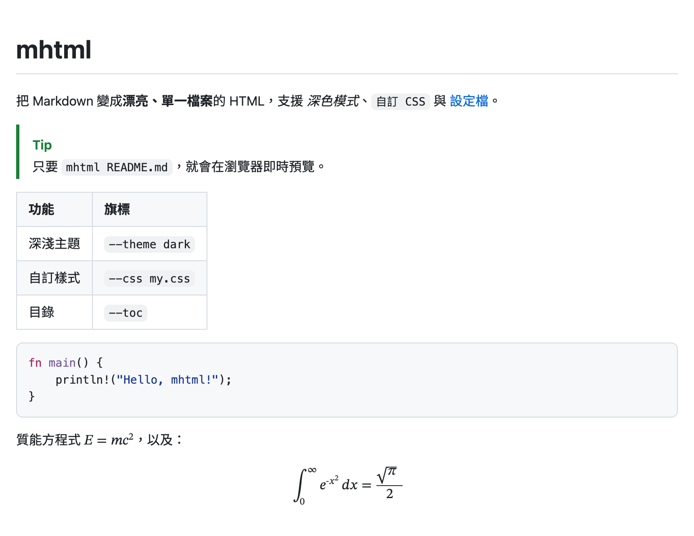
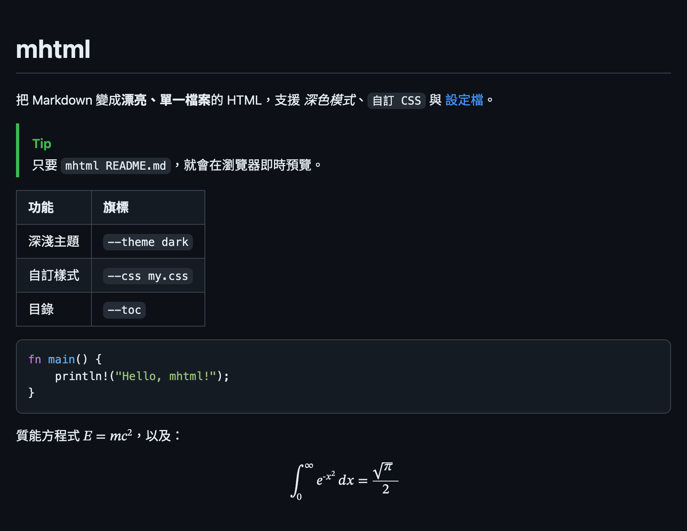

# mhtml

**English** | [繁體中文](README.md)

Turn Markdown into a beautiful, **single-file, offline-friendly** HTML page. Written in Rust: one native binary for Windows, macOS and Linux, plus an npm wrapper.

```sh
mhtml README.md                    # write a temp HTML file and open it in your browser
mhtml README.md README.html        # write an HTML file
mhtml README.md out.html --theme dark --css my.css
```

<p align="center">
  
  
</p>

## Features

- **Instant preview** — give it just an input file and it opens the rendered page in your default browser (relative images keep working).
- **Light / dark themes** — `--theme auto|light|dark`; `auto` follows the system, no JavaScript involved.
- **Adaptive presentation** — on by default (`--no-enhance` to turn off): sticky side outline for long documents, property grids and cards for compact lists, sortable/filterable/resizable tables (sortable from 2 rows, drag a header to move its column) with sticky headers and a reset control, hover-revealed copy icons on code blocks, and CJK-aware `<html lang>` and line spacing.
- **Easy styling** — CSS variables, shortcut flags, your own `.css` files, or a config file.
- **Config file** — keep your preferences in the OS-standard config folder; command-line flags override it per run.
- **Broad syntax support** — CommonMark, GFM (tables, task lists, strikethrough, footnotes, alerts), definition lists, front matter, syntax-highlighted code, LaTeX math (MathML, offline; tolerant of loose spacing such as `$ L $`), Mermaid diagrams (embedded Ondine renderer, works offline), table of contents.
- **CJK-friendly emphasis and checking** — `**label:**value` and `**「quoted」**` style markers pair up next to CJK or fullwidth punctuation (strict CommonMark and GitHub leave the `**` literal); unpaired markers always print a line-numbered warning on stderr, and `--check` turns them into a non-zero exit code for CI.
- **Safe by default** — output is sanitized (no `<script>`, `onerror`, `javascript:`…; inline `data:image/...` images are kept); opt out with `--unsafe-html`.
- **Self-contained output** — CSS is inlined, no external dependencies.

## Adaptive presentation

On by default (`--no-enhance` or `enhance = false` turns it off). mhtml reads the document's shape and adjusts the page without touching the text, its order or heading ids: long multi-section documents get a sticky side outline, wide tables widen the column (`--mhtml-wide-width`), heading-less prose gets a reading column, `Label: value` lists become property grids, short lists become cards, and tables become sortable (2+ rows), filterable, resizable, with draggable column order (drag a header, or Alt+←/→), sticky headers and stacked cards on narrow screens. A reset control restores row order, column order and widths. Code blocks reveal a copy icon at the top-right corner while hovered. CJK documents get the right `<html lang>` and roomier line spacing when `--lang` is not given.

The **Export CSV** button downloads the headers and currently visible rows in the current row and column order. The file uses UTF-8 with a BOM for Excel. Formula-like fields are escaped for spreadsheets.

## Install

```sh
npm install -g mhtml-cli     # provides the `mhtml` command
npx mhtml-cli README.md      # or run without installing
```

The unscoped `mhtml` name on npm is taken by another package, so this one is `mhtml-cli`; the command is still `mhtml`. The package is a tiny zero-dependency wrapper that downloads the native binary for your platform from GitHub Releases (SHA-256 verified). Environment variables: `MHTML_DOWNLOAD_BASE` (mirror), `MHTML_BINARY_PATH` (use a local binary), `MHTML_SKIP_DOWNLOAD`.

Or grab a binary from [Releases](https://github.com/doggy8088/mhtml/releases), or build from source (Rust 1.88+):

```sh
cargo install --git https://github.com/doggy8088/mhtml
```

## Usage

> 🤖 **For AI agents and scripts**: `mhtml --help` is a complete guide — quick start, the output contract (exit codes, stdout/stderr split), grouped examples, styling hooks, config file and troubleshooting. In automation always pass an OUTPUT (or `-`) or `--no-open`, and add `--no-config` for reproducible output.

```text
mhtml [OPTIONS] <INPUT> [OUTPUT]
```

| Usage | Meaning |
| --- | --- |
| `mhtml a.md` | Preview mode: temp file, opened in the browser |
| `mhtml a.md a.html` | Write a file (add `--open` to also open it) |
| `mhtml - -` | stdin → stdout, e.g. `cat a.md \| mhtml - -` |
| `mhtml a.md --no-open` | Preview mode without opening; prints the temp file path |
| `cat a.md \| mhtml` | Preview Markdown piped on stdin (`-` is optional); to write a file use `cat a.md \| mhtml - a.html` |

Preview files are named `<name>-<mhtml version>-<content hash>.html` (name is `Markdown` for stdin): the same page always gets the same path, while other content, flags or a new version get a new file, so an open browser tab is never overwritten.

Main flags: `-t/--theme`, `-c/--css <FILE|URL>` (repeatable), `--no-default-style`, `--accent`, `--width`, `--font`, `--font-size`, `--title`, `--lang`, `--toc`, `--toc-title`, `--no-highlight`, `--no-math`, `--no-mermaid`, `--content-only`, `--smart-punctuation`, `--unsafe-html`, `--check`, `--base`, `--config`, `--no-config`, `--init-config`, `--print-config-path`. Run `mhtml --help` for details. Every on/off flag has an opposite (`--toc` / `--no-toc`) so a single run can override the config file.

### Copy to Outlook

Run `mhtml a.md --content-only`, select all in the browser, and copy the page into Outlook. This mode keeps headings, lists, links, images and tables as HTML with browser styling. Task markers become text, and formulas and Mermaid diagrams appear as source. The mode skips themes, custom CSS, the generated table of contents and interactive controls, and sanitizes raw HTML.

Set `content_only = true` in your config to use it by default. Use `--no-content-only` to restore regular output for a run.

## Config file

Settings can live in a config file **and** be passed as flags. Precedence:

> built-in defaults < config file < command-line flags

| OS | Default location |
| --- | --- |
| macOS | `~/Library/Application Support/mhtml/config.toml` |
| Linux | `$XDG_CONFIG_HOME/mhtml/config.toml` (usually `~/.config/mhtml/config.toml`) |
| Windows | `%APPDATA%\mhtml\config.toml` |

Override with `--config <FILE>` or `$MHTML_CONFIG`. `mhtml --init-config` creates a commented template (it never overwrites an existing file).

```toml
theme = "dark"                 # "auto" | "light" | "dark"
lang = "en"
accent = "#e11d48"
width = "900px"
font = "Georgia, serif"
font_size = "17px"
toc = true
toc_title = "Contents"
highlight = true
math = true
mermaid = true
smart_punctuation = false
unsafe_html = false
default_style = true
open_browser = true
css = ["my-style.css"]        # relative to this file; "~/" and http(s) URLs work
custom_css = """
h1 { letter-spacing: .02em; }
"""
```

Unknown keys are rejected with a list of valid ones. Stylesheets apply in this order: config `css` → `custom_css` → command-line `--css`.

## Custom styling

The built-in style is driven by CSS custom properties:

```css
:root {
  --mhtml-accent: #e11d48;
  --mhtml-max-width: 70ch;
  --mhtml-font: Georgia, serif;
}
@media (prefers-color-scheme: dark) { :root { --mhtml-bg: #000; } }
```

Available: `--mhtml-bg`, `-fg`, `-muted`, `-border`, `-accent`, `-code-bg`, `-code-fg`, `-inline-code-bg`, `-quote-border`, `-table-stripe`, `-mark`, `-note`, `-tip`, `-important`, `-warning`, `-caution`, `-font`, `-mono`, `-font-size`, `-line-height`, `-max-width`, `-radius`. `<html>` carries `data-theme="auto|light|dark"`; syntax tokens use `.hl-*` classes.

## Use as a library

The converter is a Rust library (`src/lib.rs`) and the command line is a thin layer on top of it, so another CLI or app can produce the same page without shelling out.

```toml
[dependencies]
mhtml = { git = "https://github.com/doggy8088/mhtml" }

# Library only: leaves out clap, toml and the browser opener.
# mhtml = { git = "https://github.com/doggy8088/mhtml", default-features = false }
```

```rust
use mhtml::{Options, Theme};

let options = Options::default()
    .with_title("Release notes")
    .with_theme(Theme::Dark);

let doc = mhtml::to_html("# v1.2.0\n\n- faster\n- smaller", &options)
    .expect("the styling options are valid");
std::fs::write("notes.html", &doc.html).expect("write");
```

`doc` carries the whole page in `html`, plus `title`, `lang`, `body` (the `<main>` content on its own), `warnings` (emphasis markers GitHub leaves literal) and `uses_highlight` / `uses_mermaid`.

`Options` mirrors the flags and the config file: `title`, `lang`, `theme`, `base`, `default_style`, `enhance`, `content_only`, `toc` and `toc_title`, `highlight`, `math`, `mermaid`, `smart_punctuation`, `unsafe_html`, the `accent` / `width` / `font` / `font_size` shortcuts, and `extra_css` (`CssSource::Inline` or `CssSource::Link`). The fields are public, so struct-update syntax works too:

```rust
let options = mhtml::Options { unsafe_html: true, ..Default::default() };
```

Lower-level stages are public as well: `render::render` turns Markdown into a sanitized body plus the document profile, and `Page` wraps a body you built yourself. `cargo doc --no-deps --open` lists everything.

## Development

```sh
make help      # list all common tasks
make check     # fmt + clippy + all tests (same as CI)
make preview   # preview examples/example.md in the browser
make release   # optimized build at target/release/mhtml
make tag       # verify versions, then create the local vX.Y.Z tag
```

Release: bump the version in `Cargo.toml` and `npm/package.json`, then `git tag vX.Y.Z && git push --tags`. GitHub Actions builds six binaries, creates the Release and publishes the npm package via npm Trusted Publishing (OIDC, no token secret needed).

## License

[MIT](LICENSE) © 2026 Will 保哥
